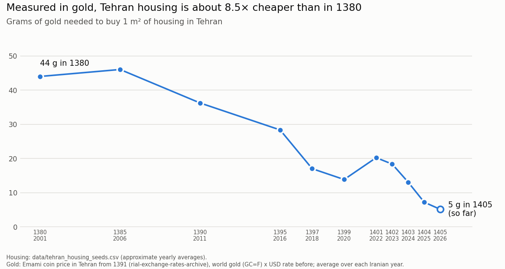

# Iran Housing, Gold & FX Data Pipeline

[](https://github.com/AAliasghar/ir-housing-gold-fx-model/actions/workflows/ci.yml)
[](LICENSE)

Apache Airflow pipelines that collect **Iranian** macro and market data (USD/IRR exchange rate, inflation, GDP, Tehran housing prices) plus a gold price series into PostgreSQL, so they can be compared over time: for example, how Tehran housing prices move against the rial, gold and inflation.

> **Status:** data-collection layer plus a first result ([Tehran housing measured in gold](#results-tehran-housing-measured-in-gold)). The pipelines load raw tables; a full analysis layer on top of them is on the [roadmap](#roadmap).

---

## Data sources

| DAG | Data | Source | Table | Schedule |
|---|---|---|---|---|
| `fx_currency_scraper` | USD/IRR rate | Yahoo Finance `USDIRR=X` for 2006–2010; [rial-exchange-rates-archive](https://github.com/SamadiPour/rial-exchange-rates-archive) (open-market sell rate, toman → rial) for the years it covers, about 2012 onward | `raw.fx_rates` | daily, incremental |
| `market_data_scraper` | Gold: GLD ETF monthly close, USD | Yahoo Finance | `raw.gold_prices` | daily, incremental (first run loads 20 years) |
| `inflation_ingestion` | Consumer-price inflation, annual % (`FP.CPI.TOTL.ZG`) | World Bank API, country `IRN` | `raw.inflation_rates` | monthly, full refresh |
| `gdp_ingestion` | GDP growth % and GDP in current USD | World Bank API, country `IRN` | `raw.gdp_data` | monthly, full refresh |
| `housing_ingestion_pipeline` | Average Tehran housing price (toman per m²) and USD rate for selected years | [`data/tehran_housing_seeds.csv`](data/tehran_housing_seeds.csv) | `raw.housing_historical_raw` | once |

### Data caveats

- **USD/IRR has two regimes.** Up to 2010 the series is the official rate (Yahoo Finance); after that it is the open-market rate from the archive. In Iran these differ a lot, so treat the jump between them as a change of source, not a market move. There can be a gap between the end of 2010 and the archive's first date.
- **Gold is a proxy.** GLD is a US gold ETF priced in USD, not the domestic Iranian gold or coin price.
- **Housing is a small seed file:** approximate yearly averages for selected Iranian (Jalali) years, 1380 (2001/02) to 1405 (2026/27), compiled by the author. From 1395 on, its USD rates are yearly averages from the rial archive.

---

## Results: Tehran housing measured in gold



From 1380 (2001) to 1405 (2026), the average price of 1 m² in Tehran rose about **468× in toman**, but only about **2× in US dollars**: almost all of the rise in toman is the rial losing value. Gold in toman rose much faster, about **4,000×**. So measured in gold, housing got much cheaper: 1 m² cost about **44 g of gold in 1380** and about **5 g in 1405**, roughly 8.5× less. Someone holding gold could buy far more housing at the end than at the start, before counting rent, which housing earns and gold does not.

| Iranian year | Housing, toman/m² | USD rate, toman | Housing, USD/m² | Gold, toman/g | Gold source | Grams of gold per m² |
|---|--:|--:|--:|--:|---|--:|
| 1380 | 310,000 | 792 | 391 | 7,047 | world gold × USD | 44.0 |
| 1385 | 850,000 | 920 | 924 | 18,468 | world gold × USD | 46.0 |
| 1390 | 2,100,000 | 1,100 | 1,909 | 57,956 | world gold × USD | 36.2 |
| 1395 | 4,300,000 | 3,638 | 1,182 | 151,656 | Emami coin | 28.4 |
| 1397 | 8,200,000 | 10,527 | 779 | 481,465 | Emami coin | 17.0 |
| 1399 | 20,000,000 | 23,174 | 863 | 1,442,630 | Emami coin | 13.9 |
| 1401 | 48,000,000 | 35,098 | 1,368 | 2,370,489 | Emami coin | 20.2 |
| 1402 | 76,000,000 | 51,779 | 1,468 | 4,136,005 | Emami coin | 18.4 |
| 1403 | 90,000,000 | 68,695 | 1,310 | 6,875,579 | Emami coin | 13.1 |
| 1404 | 115,000,000 | 111,508 | 1,031 | 15,903,106 | Emami coin | 7.2 |
| 1405 (so far) | 145,000,000 | 187,666 | 773 | 28,145,656 | Emami coin | 5.2 |

**How it's calculated:**

- **USD rate:** from 1395 on, the yearly average of the open-market rate in [rial-exchange-rates-archive](https://github.com/SamadiPour/rial-exchange-rates-archive) (the same source as the FX DAG); before that, the rate in the seed file. Housing in USD = toman price ÷ this rate.
- **Gold in toman per gram:** from 1391 on, the yearly average price of the Emami gold coin in Tehran from the same archive, divided by its 7.3224 g of pure gold. Before 1391 there is no coin data, so it is the world gold price (Yahoo Finance `GC=F`, USD per troy ounce) × the USD rate. Saved in [`data/gold_toman_yearly.csv`](data/gold_toman_yearly.csv).
- **Grams of gold per m²** = housing in toman ÷ gold in toman per gram. Every average runs over the Iranian year, 1 Farvardin to the end of Esfand.

**Read it with care:**

- The housing figures are approximate yearly averages from the seed file, not an official series. The Central Bank of Iran's monthly transaction series ended in Mordad 1403, so **1404 and 1405 are estimates**, and 1405 (145 million toman/m²) looks low next to current listing prices.
- The coin price includes a premium over the gold it contains, so from 1391 on, gold in toman is a little higher than the world price would give.
- 1405 is not over: its averages cover only the days up to the last run (2026-10-31).
- The seed years are uneven (5 years apart at the start), so this can't show anything shorter than a year, such as whether housing follows gold with a lag of a few months.
- The numbers come from [`analysis/housing_vs_gold.py`](analysis/housing_vs_gold.py), which reads the same sources directly; it does not read the Postgres tables yet.

Reproduce (writes `data/gold_toman_yearly.csv`, `docs/housing_vs_gold.csv` and `docs/housing_vs_gold.png`):

```bash
pip install jdatetime pandas requests yfinance matplotlib
python analysis/housing_vs_gold.py
```

---

## Getting started

**Requirements:** Docker with Docker Compose.

```bash
git clone https://github.com/AAliasghar/ir-housing-gold-fx-model.git
cd ir-housing-gold-fx-model

cp .env.example .env          # then change the passwords in .env
docker compose up --build -d
```

On the first start, `airflow-init` prepares the Airflow tables and creates the UI login, then the webserver and scheduler start.

- **Airflow UI:** http://localhost:8081, log in with `AIRFLOW_ADMIN_USER` / `AIRFLOW_ADMIN_PASSWORD` from `.env` (default `admin` / `admin`)
- **PostgreSQL:** `localhost:5433`, database `ir_market_data`, user and password from `.env`

New DAGs start **paused**. In the Airflow UI, switch on the DAGs you want and trigger them.

Check that data arrived:

```bash
docker compose exec postgres psql -U quant_user -d ir_market_data \
  -c "SELECT COUNT(*), MIN(date), MAX(date) FROM raw.fx_rates;"
```

### Common commands

```bash
docker compose logs -f airflow-scheduler                         # follow task logs
docker compose exec airflow-webserver airflow dags list          # list DAGs
docker compose exec airflow-webserver airflow dags trigger gdp_ingestion
docker compose down                                              # stop
docker compose down -v                                           # stop and DELETE the database volume
```

### Configuration

All settings live in `.env` (template: [`.env.example`](.env.example)):

| Variable | Used for |
|---|---|
| `POSTGRES_USER`, `POSTGRES_PASSWORD`, `POSTGRES_DB` | The Postgres container, Airflow's metadata DB and the `postgres_default` connection the DAGs use |
| `AIRFLOW_ADMIN_USER`, `AIRFLOW_ADMIN_PASSWORD` | Airflow UI login, created by `airflow-init` |
| `AIRFLOW_SECRET_KEY` | Airflow webserver secret key |

If a database volume already exists, keep the password it was created with, or reset the volume with `docker compose down -v` (this deletes the data).

---

## Project structure

```
ir-housing-gold-fx-model/
├── airflow/dags/
│   ├── fx_data_pipeline.py          # USD/IRR → raw.fx_rates
│   ├── market_data_pipeline.py      # gold (GLD) → raw.gold_prices
│   ├── inflation_pipeline.py        # World Bank CPI → raw.inflation_rates
│   ├── gdp_pipeline.py              # World Bank GDP → raw.gdp_data
│   └── housing_prices_pipeline.py   # seed CSV → raw.housing_historical_raw
├── analysis/housing_vs_gold.py      # housing priced in gold → docs/housing_vs_gold.{csv,png}
├── data/tehran_housing_seeds.csv    # housing seed data
├── data/gold_toman_yearly.csv       # gold in toman per gram per year (written by the analysis script)
├── docs/                            # results chart and table shown in this README
├── tests/                           # pytest checks, run in CI
├── .github/workflows/ci.yml         # CI: compose check + tests
├── docker-compose.yaml              # Postgres + Airflow (init, webserver, scheduler)
├── Dockerfile                       # Airflow 2.7.1 (Python 3.10) + requirements.txt
├── requirements.txt                 # libraries installed into the Airflow image
├── .env.example
└── LICENSE
```

---

## Tests

```bash
pip install -r requirements-dev.txt
pytest -v
docker compose config -q
```

The tests check what a fresh clone needs in order to run: the housing seed file is committed and readable, `.gitignore` keeps it while hiding `.env`, every file in `airflow/dags/` defines a DAG, `docker-compose.yaml` has no hardcoded credentials, and Airflow waits for the init step that creates the login. They also check the housing-vs-gold calculations (Iranian year boundaries, including leap years, and the unit conversions) without going online. CI runs them on every push and pull request.

---

## Roadmap

- [x] Tehran price per m² in USD and in gold, with a chart in this README
- [ ] Monthly Tehran housing prices, to test whether housing follows gold with a lag: how often, after how many months, and how much of the gold rise it catches up
- [ ] Analysis layer on the Postgres tables (dbt), including the real price after inflation
- [ ] Close the gap between the official (to 2010) and open-market USD/IRR series and document where they meet
- [ ] A US version of the same pipeline with FRED data (fed funds rate, Case-Shiller, gold, dollar index)
- [ ] Separate database for Airflow's metadata, and upgrade Postgres 13 (end of life)

---

## License

MIT. See [LICENSE](LICENSE).

## Author

[AAliasghar](https://github.com/AAliasghar) · [Open an issue](https://github.com/AAliasghar/ir-housing-gold-fx-model/issues)
